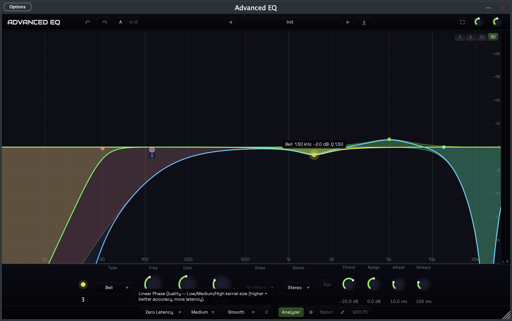

# Advanced EQ

[](LICENSE)
[](https://github.com/straplocked/advanced-eq/actions/workflows/build.yml)

An open-source parametric equalizer audio plugin built with [JUCE 7](https://juce.com/). Features 24 bands, 9 filter types, 10 slope options, dynamic EQ, linear/natural/zero-latency phase modes, EQ matching, spectrum grab, surround/Atmos support, MIDI learn, and a real-time spectrum analyzer.



## Features

### Core EQ Engine
- **24-band parametric EQ** with interactive curve display
- **9 filter types:** Bell, Low Shelf, High Shelf, Low Pass, High Pass, Notch, Band Pass, Tilt Shelf, Flat Tilt
- **10 slope options:** 6, 12, 18, 24, 36, 48, 72, 96 dB/oct, and Brickwall
- **Oversampling:** 1x, 2x, and 4x modes for reduced aliasing
- **3 processing modes:** Zero Latency (IIR), Natural Phase (mixed-phase FIR), Linear Phase (symmetric FIR)
- **Auto gain compensation:** maintains perceived loudness across EQ adjustments

### Dynamic EQ
- **Per-band dynamics** with envelope follower and bidirectional gain modulation
- **Configurable attack/release** with frequency-adaptive time constants
- **Threshold and range controls** for compression (negative range) and expansion (positive range)

### Analysis & Matching
- **Real-time spectrum analyzer** with pre/post EQ views, freeze mode, and configurable resolution (1024/2048/4096/8192)
- **Spectrum tilt compensation** for pink noise reference display
- **EQ Match:** capture reference and current spectra, auto-fit Bell bands to match the difference
- **Spectrum Grab:** click near analyzer peaks to snap new bands to spectral content

### Routing & Surround
- **Per-band stereo placement:** Stereo, Left, Right, Mid, Side
- **Surround support:** mono, stereo, 5.1, 7.1, and 7.1.4 (Atmos) bus layouts
- **Phase inversion** toggle

### Workflow
- **Undo/Redo** with Cmd+Z / Cmd+Shift+Z keyboard shortcuts
- **A/B comparison** with state snapshot toggle and copy
- **Band solo** monitor mode for isolating individual band contributions
- **MIDI Learn** -- map any CC to any parameter with learn mode
- **Inter-instance collision detection** -- highlights overlapping bands between plugin instances
- **57 factory presets** across Instruments, Bus, and Mastering categories, plus user preset save/load

### UI
- **Interactive curve** -- click to create bands, drag to adjust, scroll to change Q, double-click to remove
- **Piano overlay** with note markers along the frequency axis
- **Output level meter** with peak and RMS display
- **Window size presets:** Mini, Small, Medium, Large, XL
- **Analog mode** with proportional Q, soft saturation, channel crosstalk, and noise floor
- **Studio rack gear visual design** with dark theme

## Plugin Formats

| Format     | macOS | Windows | Linux |
|------------|-------|---------|-------|
| VST3       | Yes   | Yes     | Yes   |
| AU         | Yes   | --      | --    |
| CLAP       | Yes   | Yes     | Yes   |
| AAX        | Yes*  | Yes*    | --    |
| Standalone | Yes   | Yes     | Yes   |

*AAX requires the Avid AAX SDK (set `AAX_SDK_PATH` in CMake).

## Installation

Download the latest release for your platform from the [Releases page](https://github.com/straplocked/advanced-eq/releases).

### macOS
1. Download `AdvancedEQ-x.y.z-macOS.dmg`
2. Open the DMG and drag plugin files to:
   - **VST3** → `/Library/Audio/Plug-Ins/VST3/`
   - **AU** → `/Library/Audio/Plug-Ins/Components/`
   - **CLAP** → `/Library/Audio/Plug-Ins/CLAP/`
3. On first launch, right-click → Open to bypass Gatekeeper (unsigned builds)
4. Restart your DAW and rescan plugins

### Windows
1. Download `AdvancedEQ-x.y.z-Windows.exe`
2. Run the installer — it places the VST3 plugin in the standard location
3. Restart your DAW and rescan plugins

### Linux
1. Download `AdvancedEQ-x.y.z-Linux.tar.gz`
2. Extract and run `./install.sh` (installs to `~/.vst3/` and `~/.local/bin/`)
3. Restart your DAW and rescan plugins

## Building

### Requirements

- CMake 3.25+
- C++20-compatible compiler (Clang 13+, GCC 11+, MSVC 2022+)
- Git (for submodules)

### Quick Start

```bash
git clone --recursive https://github.com/straplocked/advanced-eq.git
cd advanced-eq
cmake -B build -DCMAKE_BUILD_TYPE=Release
cmake --build build --config Release -j
```

### macOS with 10.15 SDK

If targeting x86_64 only (e.g., macOS 10.15 SDK without arm64 support):

```bash
cmake -B build -DCMAKE_BUILD_TYPE=Release -DCMAKE_OSX_ARCHITECTURES=x86_64
cmake --build build --config Release -j
```

### CLAP Format

CLAP support requires the `clap-juce-extensions` submodule. If you cloned without `--recursive`:

```bash
git submodule update --init --recursive
```

### Build Options

| Option                      | Default | Description              |
|-----------------------------|---------|--------------------------|
| `ADVANCED_EQ_BUILD_TESTS`   | OFF     | Build unit tests         |
| `CMAKE_OSX_ARCHITECTURES`   | --      | Target architecture(s)   |
| `AAX_SDK_PATH`              | --      | Path to AAX SDK for AAX builds |

## Architecture

```
Audio Input (mono / stereo / 5.1 / 7.1 / 7.1.4)
    |
    v
[MIDI Learn] ---------> CC-to-parameter mapping
    |
    v
[Pre-EQ FFT] ---------> Spectrum Analyzer (UI)
    |
    v
ProcessingChain  (mode: IIR / Natural Phase / Linear Phase)
    |
    |--- IIR Mode (zero latency):
    |       |--- [Optional 2x/4x Oversampling]
    |       |--- Pass 1: Stereo bands (all channels)
    |       |--- Pass 2: Left-only bands
    |       |--- Pass 3: Right-only bands
    |       '--- Pass 4: Mid/Side encode -> Mid bands -> Side bands -> decode
    |       |--- [Band Solo monitor filter]
    |       '--- [Analog Mode: saturation / crosstalk / noise floor]
    |
    |--- Natural Phase Mode (FIR, mixed-phase, ~23ms latency)
    |
    '--- Linear Phase Mode (FIR, symmetric, ~93ms latency)
    |
    v
[Auto Gain Compensation]
    |
    v
[Output Gain + Phase Inversion]
    |
    v
[Post-EQ FFT] --------> Spectrum Analyzer (UI)
    |
    v
[Level Meter] ---------> Peak + RMS display
    |
    v
Audio Output
```

**DSP engine:** Cytomic TPT (Topology-Preserving Transform) state variable filters, cascaded for higher-order slopes with Butterworth pole placement.

**Parameter system:** 298 parameters (24 bands x 12 + 10 global) with lock-free atomic reads on the audio thread via `BandParameterAttachment`.

**UI:** Timer-driven at 30 Hz. Lock-free `TripleBuffer` transfers FFT data from the audio thread to the UI thread.

See [docs/architecture.md](docs/architecture.md) for full details.

## Project Structure

```
advanced-eq/
├── source/
│   ├── PluginProcessor.h/cpp    # Audio processor entry point
│   ├── PluginEditor.h/cpp       # UI editor entry point
│   ├── dsp/                     # DSP engine
│   │   ├── SVFFilter            # Cytomic TPT state variable filter
│   │   ├── CascadedFilter       # Multi-section cascading for slopes
│   │   ├── EqBand               # Single EQ band (N-channel, dynamic EQ)
│   │   ├── ProcessingChain      # Orchestrates all 24 bands + oversampling
│   │   ├── LinearPhaseEngine    # FIR convolution (linear phase mode)
│   │   ├── NaturalPhaseEngine   # Mixed-phase FIR (natural phase mode)
│   │   ├── EnvelopeFollower     # Ballistic peak/RMS envelope detector
│   │   ├── DynamicProcessor     # Bidirectional dynamic gain computation
│   │   ├── EQMatcher            # Spectrum matching algorithm
│   │   ├── FilterTypes          # Enums and slope utilities
│   │   ├── BiquadCoefficients   # Biquad coefficient math
│   │   └── MidSideProcessor     # Mid/Side encode/decode
│   ├── analyzer/                # Spectrum analysis
│   │   ├── FFTProcessor         # Multi-resolution windowed FFT + capture
│   │   ├── SpectrumAnalyzer     # Log-frequency resampling + peak detection
│   │   └── TripleBuffer         # Lock-free audio-to-UI transfer
│   ├── parameters/              # Parameter management
│   │   ├── ParameterIDs         # ID naming conventions
│   │   ├── ParameterLayout      # APVTS parameter definitions
│   │   └── BandParameterAttachment  # Lock-free parameter bridge
│   ├── presets/                 # Preset system
│   │   ├── PresetManager        # Load/save/navigate presets
│   │   ├── FactoryPresets       # 57 built-in presets
│   │   └── PresetData           # Preset data structures
│   ├── midi/                    # MIDI integration
│   │   └── MidiLearnManager     # CC-to-parameter mapping with learn mode
│   ├── ipc/                     # Inter-process communication
│   │   └── InstanceRegistry     # Cross-instance collision detection
│   ├── ui/                      # User interface
│   │   ├── components/
│   │   │   ├── EqCurveDisplay   # Interactive EQ curve + spectrum grab
│   │   │   ├── HeaderToolbar    # Presets, mode, undo/redo, A/B, match
│   │   │   ├── BottomControlStrip  # Band parameter + dynamic EQ knobs
│   │   │   ├── BandControlPanel # Filter type/slope selector
│   │   │   ├── EQMatchPanel     # EQ Match workflow UI
│   │   │   ├── LevelMeter       # Peak + RMS output meter
│   │   │   └── PianoOverlay     # Note name markers on frequency axis
│   │   └── LookAndFeel/
│   │       ├── AdvancedEqLookAndFeel  # Custom widget rendering
│   │       └── ColourPalette    # Centralized color scheme
│   └── utils/                   # Utilities
│       ├── Constants            # Global constants
│       ├── FrequencyUtils       # MIDI/frequency conversions
│       └── MathUtils            # dB, coordinate mapping
├── JUCE/                        # JUCE 7.0.12 (submodule)
├── libs/clap-juce-extensions/   # CLAP support (submodule)
├── docs/                        # Architecture documentation
├── tests/                       # Unit tests
├── cmake/                       # Platform build config
└── resources/                   # Fonts, icons, presets
```

## Contributing

See [CONTRIBUTING.md](CONTRIBUTING.md) for development setup, code style, and contribution guidelines.

## License

This project is licensed under the [GNU General Public License v3.0 or later](LICENSE).
